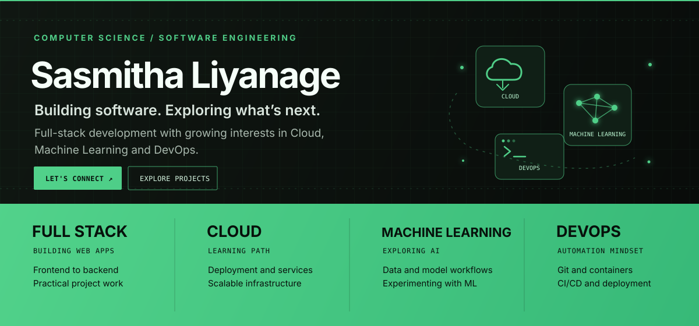
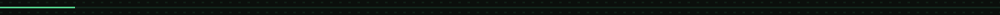
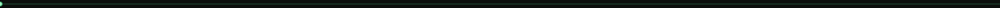

 

&nbsp;

&nbsp;

&nbsp;

  

**Computer Science Undergraduate · Full Stack Developer**

*Minimal UI. Thoughtful code. Constant motion.*

---

## `01` — A little about me

I'm a BSc (Hons) Computer Science undergraduate who enjoys building full-stack applications and exploring modern web technologies.

- Building web applications from interface to backend
- Exploring tools and technologies that make products useful and reliable
- Always learning, experimenting, and turning ideas into working projects

---

## `02` — Tech I work with

---

## `03` — Selected work

<table>
  <tr>
    <td width="50%" valign="top">

### 🧾 POS System

A point-of-sale system built for a graphic design agency using JavaScript.

[Explore repository ↗](https://github.com/SasmithaLiyanage/pos-system)

</td>
    <td width="50%" valign="top">

### 🏋️ Gym Management System

A PHP-based web application for managing gym memberships and operations.

[Explore repository ↗](https://github.com/SasmithaLiyanage/gym-management-system)

</td>
  </tr>
  <tr>
    <td width="50%" valign="top">

### 🏝️ CeylonAdvisor

A full-stack booking platform built with Spring Boot and JavaScript, connecting travelers with property owners and featuring a partner dashboard.

[Explore repository ↗](https://github.com/SasmithaLiyanage/ceylonadvisor)

</td>
    <td width="50%" valign="top">

### 🌐 Personal Portfolio

A personal website showcasing my work, skills, and developer journey.

[Visit portfolio ↗](https://sasmithaliyanage.github.io)

</td>
  </tr>
</table>

---

## `04` — GitHub activity

&nbsp;

  

---

  

**Have an interesting idea? Let's connect.**

<a href="https://www.linkedin.com/in/sasmitha-liyanage-a58068202">LinkedIn</a>
&nbsp;·&nbsp;
<a href="mailto:sasmithaliyanage@gmail.com">Email me</a>
&nbsp;·&nbsp;
<a href="https://sasmithaliyanage.github.io">Portfolio</a>

  

Designed with a minimal, motion-inspired aesthetic in near-black and Motion green.

